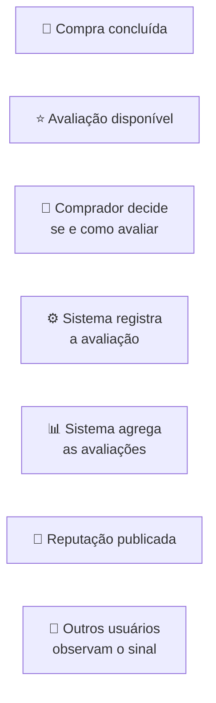
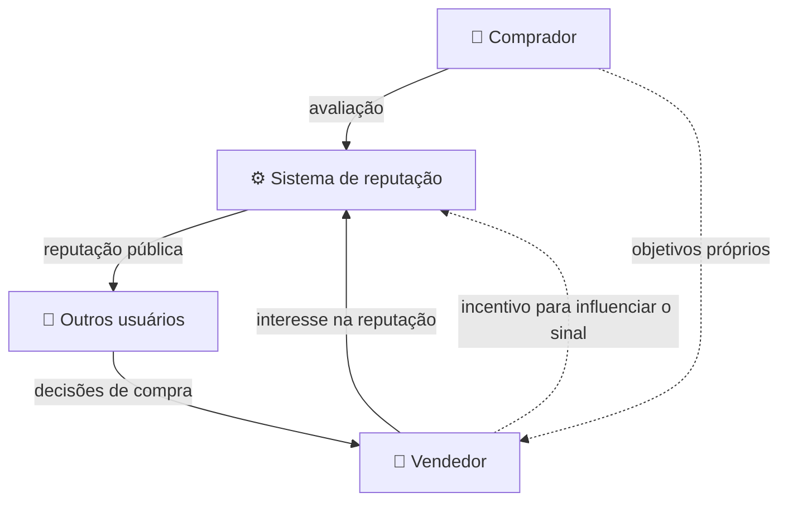
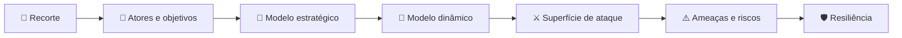
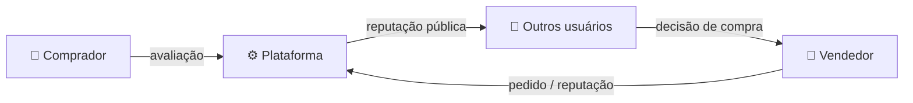
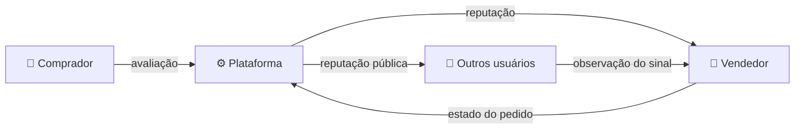
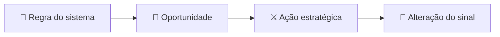

# Trabalho 1

> **Análise adversarial do subsistema de reputação da Inclusivo**

---

## Visão geral

| Informação              | Detalhe                                                           |
| ----------------------- | ----------------------------------------------------------------- |
| **Sistema**             | Inclusivo                                                         |
| **Domínio**             | E-commerce de calçados                                            |
| **Objeto de análise**   | Subsistema de reputação dos vendedores                            |
| **Interação analisada** | Avaliação do comprador e formação da reputação                    |
| **Natureza**            | Sistema adversarial e multiagente                                 |
| **Objetivo**            | Analisar incentivos, exploração de regras e adaptação estratégica |

---

## 1. Objetivo

O trabalho analisa uma interação específica da **Inclusivo** como um sistema adversarial.

O objetivo é identificar como as regras utilizadas para registrar, modificar e agregar avaliações podem criar **incentivos para comportamentos estratégicos**, permitindo que sejam exploradas características do sistema para alcançar seus próprios objetivos.

A análise é **conceitual e baseada no sistema desenvolvido no TCC**. O resultado da análise servirá como base para o desenvolvimento posterior da solução no **Trabalho 2**.

---

## 2. Sistema analisado

O **Inclusivo** é um e-commerce voltado à comercialização de calçados, em pares ou individuais. Após uma compra, o sistema permite que o comprador registre uma avaliação sobre sua experiência. Essas avaliações são posteriormente utilizadas para formar a **reputação pública do vendedor**.

Essa reputação funciona como um **sinal de confiança** para outros usuários, influenciando a percepção sobre a experiência de comprar daquele vendedor.

### O que estamos analisando?

O foco é:



---

## 3. Recorte da interação adversarial

A interação estudada é composta por duas decisões principais:

| Participante / mecanismo    | Decisão analisada                                          |
| --------------------------- | ---------------------------------------------------------- |
| 👤 **Comprador**            | Avaliar ou não o pedido e escolher a nota atribuída        |
| ⚙️ **Sistema de reputação** | Transformar avaliações individuais em um indicador público |

O interesse do trabalho está no momento em que o participante deixa de agir apenas de acordo com o resultado imediato e passa a considerar:

> **“Como posso agir levando em conta as regras do sistema e o comportamento esperado dos outros participantes?”**

Esse é o ponto em que a interação deixa de ser apenas funcional e passa a apresentar características estratégicas.

---

## 4. Por que essa interação é adversarial?

A interação apresenta características de um sistema adversarial porque diferentes participantes possuem **objetivos próprios** e suas decisões podem modificar os resultados obtidos pelos demais.

O comprador pode ter interesse em registrar uma avaliação que represente sua experiência, assim como o vendedor, por outro lado, possui interesse em preservar ou melhorar sua reputação pública.

Ao mesmo tempo, a plataforma utiliza as avaliações para produzir um sinal que deve continuar sendo útil para outros usuários. Isso cria uma relação onde:



O problema analisado não é simplesmente a ocorrência de erros ou comportamentos acidentais. O foco está na situação em que um participante:

1. **observa as regras do sistema;**
2. **identifica uma oportunidade de obter vantagem;**
3. **escolhe uma ação estratégica;**
4. **observa o resultado produzido;**
5. **pode adaptar seu comportamento posteriormente.**

---

## 5. Propriedade que deve ser preservada

O principal ativo considerado nesta análise é a:

> ### **Confiabilidade da reputação pública do vendedor**

A reputação deve continuar funcionando como um **sinal útil da experiência dos compradores**, mesmo quando os participantes possuem incentivos para agir estrategicamente.

Em outras palavras:

```text
Avaliações reais
      ↓
   Agregação
      ↓
Reputação pública
      ↓
Sinal confiável
      ↓
Decisão de outros usuários
```

Portanto, o objetivo é compreender **como as regras do sistema podem alterar os incentivos desses comportamentos** e quais mecanismos podem preservar a utilidade do sinal público.

---

## 6. Fronteira do estudo

Para evitar que o trabalho se transforme em uma análise genérica de segurança ou de todo o sistema, o escopo fica delimitado da seguinte forma:

| Dentro do escopo ✅            | Fora do escopo ❌               |
| ------------------------------ | ------------------------------- |
| Avaliação após uma compra      | Pagamento                       |
| Decisão de atribuição da nota  | Logística                       |
| Formação da reputação          | Carrinho                        |
| Agregação das avaliações       | Cadastro de produtos            |
| Alteração/manipulação do sinal | Funcionamento geral             |
| Estratégias dos participantes  | Segurança completa da aplicação |
| Adaptação diante das regras    | Ataques à infraestrutura        |

---

## Pergunta central

> **Como as regras do subsistema de reputação do Inclusivo podem criar incentivos para comportamentos estratégicos e permitir que participantes explorem o mecanismo de avaliação em benefício próprio, comprometendo a confiabilidade da reputação pública?**

---

### 🔗 Relação com as próximas etapas

A partir deste recorte, o trabalho será desenvolvido progressivamente:



Cada etapa será utilizada como base para a seguinte, mantendo o foco na mesma interação adversarial.

---

## 7. Atores e objetivos

A interação analisada envolve participantes com objetivos diferentes, que podem influenciar o resultado da reputação pública.

| Ator                   | Papel                                            | Objetivo                                                     |
| ---------------------- | ------------------------------------------------ | ------------------------------------------------------------ |
| 👤 **Comprador**       | Realiza a compra e pode avaliar                  | Representar sua experiência e obter uma experiência adequada |
| 🏪 **Vendedor**        | Fornece o produto e participa do fluxo do pedido | Realizar vendas e preservar ou melhorar sua reputação        |
| ⚙️ **Plataforma**      | Aplica as regras e processa as avaliações        | Manter a reputação como um sinal útil e confiável            |
| 👀 **Outros usuários** | Consultam a reputação                            | Utilizar informações confiáveis para decidir sobre compras   |

### Conflito de interesses

O principal conflito ocorre quando o interesse do vendedor em **manter uma reputação favorável** pode divergir do objetivo de preservar a reputação como um **sinal fiel das experiências dos compradores**.

A interação pode ser resumida como:



---

## 8. Objetivos estratégicos

Para a análise posterior, os interesses centrais podem ser resumidos em:

| Participante           | Interesse estratégico                                                          |
| ---------------------- | ------------------------------------------------------------------------------ |
| 👤 **Comprador**       | Registrar ou não uma avaliação de acordo com sua experiência e seus incentivos |
| 🏪 **Vendedor**        | Maximizar os benefícios de sua reputação pública                               |
| ⚙️ **Plataforma**      | Preservar a confiabilidade do mecanismo de reputação                           |
| 👀 **Outros usuários** | Tomar decisões com base em informações confiáveis                              |

Essa diferença de objetivos é o ponto de partida para analisar **comportamentos estratégicos, exploração das regras e adaptação** nas próximas etapas.

---

## 9. Capacidades dos atores

Cada participante possui capacidades diferentes dentro da interação analisada. Apenas as ações relacionadas à **avaliação e reputação** são consideradas neste trabalho.

| Ator                   | Capacidades relevantes                                                                         |
| ---------------------- | ---------------------------------------------------------------------------------------------- |
| 👤 **Comprador**       | Decidir se avalia, escolher a nota e registrar sua avaliação                                   |
| 🏪 **Vendedor**        | Atualizar o estado do pedido e acompanhar sua reputação                                        |
| ⚙️ **Plataforma**      | Liberar avaliações conforme as regras, registrar avaliações, agregá-las e publicar a reputação |
| 👀 **Outros usuários** | Consultar a reputação e as avaliações publicadas                                               |

---

## 10. Informações observáveis

As decisões dos participantes dependem das informações que conseguem observar durante a interação.

| Ator                   | Informações observáveis relevantes                                          |
| ---------------------- | --------------------------------------------------------------------------- |
| 👤 **Comprador**       | Estado do próprio pedido e possibilidade de avaliação                       |
| 🏪 **Vendedor**        | Estado dos pedidos relacionados às suas vendas e sua reputação publicada    |
| ⚙️ **Plataforma**      | Pedidos, avaliações registradas e dados utilizados na formação da reputação |
| 👀 **Outros usuários** | Reputação pública e avaliações disponíveis                                  |

A reputação publicada funciona como o principal **sinal observável** entre os participantes.



### Assimetria de informação

Nem todos os participantes possuem acesso às mesmas informações.

A plataforma possui acesso aos dados utilizados no processo de avaliação e agregação, enquanto outros usuários observam principalmente o **resultado publicado**.

Essa diferença cria uma assimetria que será relevante para a análise estratégica:

> **quem possui mais informações sobre o funcionamento e o estado da interação pode identificar oportunidades que não são igualmente visíveis aos demais participantes.**

---

## 11. Custos e restrições

As ações dos participantes não são ilimitadas. O sistema possui regras que restringem quando uma avaliação pode ser realizada e como ela participa da reputação.

| Elemento                      | Restrição / custo                                                               |
| ----------------------------- | ------------------------------------------------------------------------------- |
| ⭐ **Avaliação**              | Só pode ocorrer quando o pedido está disponível para avaliação                  |
| 👤 **Comprador**              | Precisa possuir uma compra relacionada ao vendedor para participar da avaliação |
| 🏪 **Vendedor**               | Possui influência sobre o estado do pedido utilizado para liberar a avaliação   |
| 📊 **Reputação**              | É formada a partir das avaliações registradas                                   |
| 🔄 **Alteração da avaliação** | A avaliação pode ser modificada, afetando novamente o sinal publicado           |

Neste modelo, o principal custo estratégico não é necessariamente financeiro.

O custo relevante é o **esforço necessário para realizar uma ação e a possibilidade de ela ser limitada pelas regras do sistema**.

---

## 12. Pressupostos e modos de falha

A análise parte de alguns pressupostos sobre o funcionamento atual do sistema.

| Pressuposto                                                          | Possível modo de falha                                                                            |
| -------------------------------------------------------------------- | ------------------------------------------------------------------------------------------------- |
| **P1.** O pedido entregue representa uma compra concluída.           | O vendedor controla o estado `delivered`, podendo influenciar quando a avaliação fica disponível. |
| **P2.** A avaliação representa uma experiência real de compra.       | Múltiplas contas ou compras podem permitir a criação de avaliações adicionais.                    |
| **P3.** A média das avaliações representa adequadamente a reputação. | Poucas avaliações ou avaliações manipuladas podem alterar significativamente o indicador.         |
| **P4.** Avaliações problemáticas podem ser reportadas.               | A existência de uma denúncia não garante, por si só, que haverá uma ação posterior sobre ela.     |

## 13. Relação entre regras e exploração

Os pressupostos anteriores mostram como uma regra aparentemente funcional pode criar uma oportunidade estratégica.



Por exemplo, se o estado do pedido influencia a disponibilidade da avaliação e esse estado pode ser alterado pelo próprio vendedor, existe uma relação entre uma **regra operacional** e o **resultado estratégico da reputação**.

Essa relação será utilizada nos próximos modelos para identificar quais ações podem gerar vantagem e como o sistema pode responder a elas.

---
