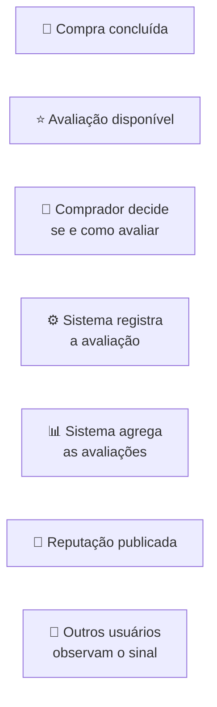
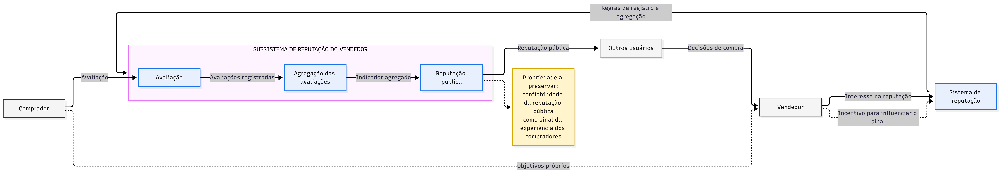
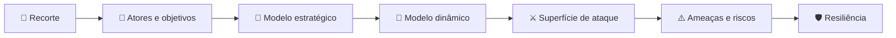
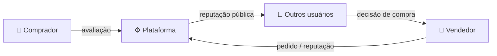
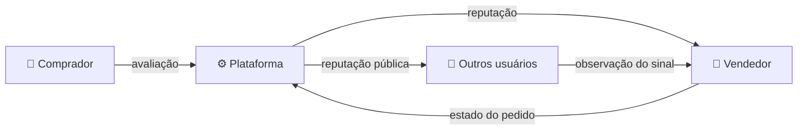
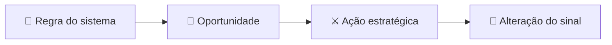
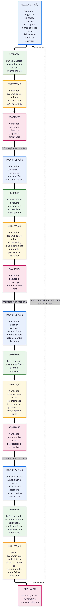
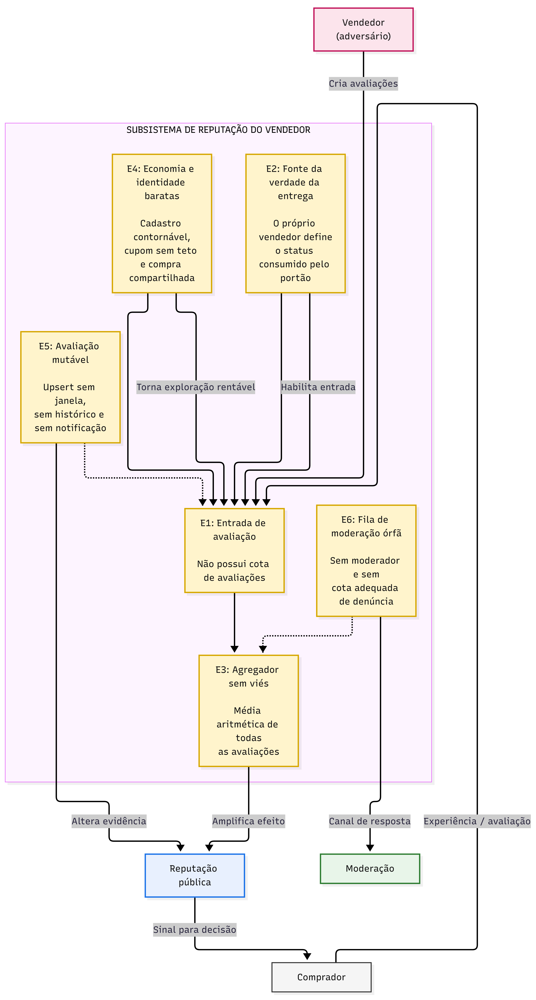

# Trabalho 1

> **Análise adversarial do subsistema de reputação da Inclusivo**

---

## Visão geral

| Informação              | Detalhe                                                           |
| ----------------------- | ----------------------------------------------------------------- |
| **Sistema**             | Inclusivo                                                         |
| **Domínio**             | E-commerce de calçados                                            |
| **Objeto de análise**   | Subsistema de reputação dos vendedores                            |
| **Interação analisada** | Avaliação do comprador e formação da reputação                    |
| **Natureza**            | Sistema adversarial e multiagente                                 |
| **Objetivo**            | Analisar incentivos, exploração de regras e adaptação estratégica |

---

## 1. Objetivo

O trabalho analisa uma interação específica da **Inclusivo** como um sistema adversarial.

O objetivo é identificar como as regras utilizadas para registrar, modificar e agregar avaliações podem criar **incentivos para comportamentos estratégicos**, permitindo que sejam exploradas características do sistema para alcançar seus próprios objetivos.

A análise é **conceitual e baseada no sistema desenvolvido no TCC**. O resultado da análise servirá como base para o desenvolvimento posterior da solução no **Trabalho 2**.

---

## 2. Sistema analisado

O **Inclusivo** é um e-commerce voltado à comercialização de calçados, em pares ou individuais. Após uma compra, o sistema permite que o comprador registre uma avaliação sobre sua experiência. Essas avaliações são posteriormente utilizadas para formar a **reputação pública do vendedor**.

Essa reputação funciona como um **sinal de confiança** para outros usuários, influenciando a percepção sobre a experiência de comprar daquele vendedor.

### O que estamos analisando?

O foco é:



---

## 3. Recorte da interação adversarial

A interação estudada é composta por duas decisões principais:

| Participante / mecanismo    | Decisão analisada                                          |
| --------------------------- | ---------------------------------------------------------- |
| 👤 **Comprador**            | Avaliar ou não o pedido e escolher a nota atribuída        |
| ⚙️ **Sistema de reputação** | Transformar avaliações individuais em um indicador público |

O interesse do trabalho está no momento em que o participante deixa de agir apenas de acordo com o resultado imediato e passa a considerar:

> **“Como posso agir levando em conta as regras do sistema e o comportamento esperado dos outros participantes?”**

Esse é o ponto em que a interação deixa de ser apenas funcional e passa a apresentar características estratégicas.

---

## 4. Por que essa interação é adversarial?

A interação apresenta características de um sistema adversarial porque diferentes participantes possuem **objetivos próprios** e suas decisões podem modificar os resultados obtidos pelos demais.

O comprador pode ter interesse em registrar uma avaliação que represente sua experiência, assim como o vendedor, por outro lado, possui interesse em preservar ou melhorar sua reputação pública.

Ao mesmo tempo, a plataforma utiliza as avaliações para produzir um sinal que deve continuar sendo útil para outros usuários. Isso cria uma relação onde:



_Figura 1 — Contexto do subsistema de reputação do vendedor._

O problema analisado não é simplesmente a ocorrência de erros ou comportamentos acidentais. O foco está na situação em que um participante:

1. **observa as regras do sistema;**
2. **identifica uma oportunidade de obter vantagem;**
3. **escolhe uma ação estratégica;**
4. **observa o resultado produzido;**
5. **pode adaptar seu comportamento posteriormente.**

---

## 5. Propriedade que deve ser preservada

O principal ativo considerado nesta análise é a:

> ### **Confiabilidade da reputação pública do vendedor**

A reputação deve continuar funcionando como um **sinal útil da experiência dos compradores**, mesmo quando os participantes possuem incentivos para agir estrategicamente.

Em outras palavras:

```text
Avaliações reais
      ↓
   Agregação
      ↓
Reputação pública
      ↓
Sinal confiável
      ↓
Decisão de outros usuários
```

Portanto, o objetivo é compreender **como as regras do sistema podem alterar os incentivos desses comportamentos** e quais mecanismos podem preservar a utilidade do sinal público.

---

## 6. Fronteira do estudo

Para evitar que o trabalho se transforme em uma análise genérica de segurança ou de todo o sistema, o escopo fica delimitado da seguinte forma:

| Dentro do escopo ✅            | Fora do escopo ❌               |
| ------------------------------ | ------------------------------- |
| Avaliação após uma compra      | Pagamento                       |
| Decisão de atribuição da nota  | Logística                       |
| Formação da reputação          | Carrinho                        |
| Agregação das avaliações       | Cadastro de produtos            |
| Alteração/manipulação do sinal | Funcionamento geral             |
| Estratégias dos participantes  | Segurança completa da aplicação |
| Adaptação diante das regras    | Ataques à infraestrutura        |

---

## Pergunta central

> **Como as regras do subsistema de reputação do Inclusivo podem criar incentivos para comportamentos estratégicos e permitir que participantes explorem o mecanismo de avaliação em benefício próprio, comprometendo a confiabilidade da reputação pública?**

---

### 🔗 Relação com as próximas etapas

A partir deste recorte, o trabalho será desenvolvido progressivamente:



Cada etapa será utilizada como base para a seguinte, mantendo o foco na mesma interação adversarial.

---

## 7. Atores e objetivos

A interação analisada envolve participantes com objetivos diferentes, que podem influenciar o resultado da reputação pública.

| Ator                   | Papel                                            | Objetivo                                                     |
| ---------------------- | ------------------------------------------------ | ------------------------------------------------------------ |
| 👤 **Comprador**       | Realiza a compra e pode avaliar                  | Representar sua experiência e obter uma experiência adequada |
| 🏪 **Vendedor**        | Fornece o produto e participa do fluxo do pedido | Realizar vendas e preservar ou melhorar sua reputação        |
| ⚙️ **Plataforma**      | Aplica as regras e processa as avaliações        | Manter a reputação como um sinal útil e confiável            |
| 👀 **Outros usuários** | Consultam a reputação                            | Utilizar informações confiáveis para decidir sobre compras   |

### Conflito de interesses

O principal conflito ocorre quando o interesse do vendedor em **manter uma reputação favorável** pode divergir do objetivo de preservar a reputação como um **sinal fiel das experiências dos compradores**.

A interação pode ser resumida como:



---

## 8. Objetivos estratégicos

Para a análise posterior, os interesses centrais podem ser resumidos em:

| Participante           | Interesse estratégico                                                          |
| ---------------------- | ------------------------------------------------------------------------------ |
| 👤 **Comprador**       | Registrar ou não uma avaliação de acordo com sua experiência e seus incentivos |
| 🏪 **Vendedor**        | Maximizar os benefícios de sua reputação pública                               |
| ⚙️ **Plataforma**      | Preservar a confiabilidade do mecanismo de reputação                           |
| 👀 **Outros usuários** | Tomar decisões com base em informações confiáveis                              |

Essa diferença de objetivos é o ponto de partida para analisar **comportamentos estratégicos, exploração das regras e adaptação** nas próximas etapas.

---

## 9. Capacidades dos atores

Cada participante possui capacidades diferentes dentro da interação analisada. Apenas as ações relacionadas à **avaliação e reputação** são consideradas neste trabalho.

| Ator                   | Capacidades relevantes                                                                         |
| ---------------------- | ---------------------------------------------------------------------------------------------- |
| 👤 **Comprador**       | Decidir se avalia, escolher a nota e registrar sua avaliação                                   |
| 🏪 **Vendedor**        | Atualizar o estado do pedido e acompanhar sua reputação                                        |
| ⚙️ **Plataforma**      | Liberar avaliações conforme as regras, registrar avaliações, agregá-las e publicar a reputação |
| 👀 **Outros usuários** | Consultar a reputação e as avaliações publicadas                                               |

---

## 10. Informações observáveis

As decisões dos participantes dependem das informações que conseguem observar durante a interação.

| Ator                   | Informações observáveis relevantes                                          |
| ---------------------- | --------------------------------------------------------------------------- |
| 👤 **Comprador**       | Estado do próprio pedido e possibilidade de avaliação                       |
| 🏪 **Vendedor**        | Estado dos pedidos relacionados às suas vendas e sua reputação publicada    |
| ⚙️ **Plataforma**      | Pedidos, avaliações registradas e dados utilizados na formação da reputação |
| 👀 **Outros usuários** | Reputação pública e avaliações disponíveis                                  |

A reputação publicada funciona como o principal **sinal observável** entre os participantes.



### Assimetria de informação

Nem todos os participantes possuem acesso às mesmas informações.

A plataforma possui acesso aos dados utilizados no processo de avaliação e agregação, enquanto outros usuários observam principalmente o **resultado publicado**.

Essa diferença cria uma assimetria que será relevante para a análise estratégica:

> **quem possui mais informações sobre o funcionamento e o estado da interação pode identificar oportunidades que não são igualmente visíveis aos demais participantes.**

---

## 11. Custos e restrições

As ações dos participantes não são ilimitadas. O sistema possui regras que restringem quando uma avaliação pode ser realizada e como ela participa da reputação.

| Elemento                      | Restrição / custo                                                               |
| ----------------------------- | ------------------------------------------------------------------------------- |
| ⭐ **Avaliação**              | Só pode ocorrer quando o pedido está disponível para avaliação                  |
| 👤 **Comprador**              | Precisa possuir uma compra relacionada ao vendedor para participar da avaliação |
| 🏪 **Vendedor**               | Possui influência sobre o estado do pedido utilizado para liberar a avaliação   |
| 📊 **Reputação**              | É formada a partir das avaliações registradas                                   |
| 🔄 **Alteração da avaliação** | A avaliação pode ser modificada, afetando novamente o sinal publicado           |

Neste modelo, o principal custo estratégico não é necessariamente financeiro.

O custo relevante é o **esforço necessário para realizar uma ação e a possibilidade de ela ser limitada pelas regras do sistema**.

---

## 12. Pressupostos e modos de falha

A análise parte de alguns pressupostos sobre o funcionamento atual do sistema.

| Pressuposto                                                          | Possível modo de falha                                                                            |
| -------------------------------------------------------------------- | ------------------------------------------------------------------------------------------------- |
| **P1.** O pedido entregue representa uma compra concluída.           | O vendedor controla o estado `delivered`, podendo influenciar quando a avaliação fica disponível. |
| **P2.** A avaliação representa uma experiência real de compra.       | Múltiplas contas ou compras podem permitir a criação de avaliações adicionais.                    |
| **P3.** A média das avaliações representa adequadamente a reputação. | Poucas avaliações ou avaliações manipuladas podem alterar significativamente o indicador.         |
| **P4.** Avaliações problemáticas podem ser reportadas.               | A existência de uma denúncia não garante, por si só, que haverá uma ação posterior sobre ela.     |

## 13. Relação entre regras e exploração

Os pressupostos anteriores mostram como uma regra aparentemente funcional pode criar uma oportunidade estratégica.



Por exemplo, se o estado do pedido influencia a disponibilidade da avaliação e esse estado pode ser alterado pelo próprio vendedor, existe uma relação entre uma **regra operacional** e o **resultado estratégico da reputação**.

Essa relação será utilizada nos próximos modelos para identificar quais ações podem gerar vantagem e como o sistema pode responder a elas.

---

## 14. Modelo estratégico estático

Para representar a interação de forma simplificada, consideramos dois participantes centrais:

- 👤 **Comprador**
- 🏪 **Vendedor**

A plataforma permanece como o mecanismo que aplica as regras do sistema. Neste modelo estático, suas regras são consideradas **fixas**.

### 🎯 Ações dos participantes

O comprador possui duas estratégias simplificadas:

| Código | Estratégia            | Descrição                                                              |
| ------ | --------------------- | ---------------------------------------------------------------------- |
| **A1** | Avaliação honesta     | Registra uma avaliação compatível com sua experiência                  |
| **A2** | Abstenção estratégica | Não registra uma avaliação, preservando sua posição diante do vendedor |

O vendedor também possui duas estratégias:

| Código | Estratégia                 | Descrição                                                                 |
| ------ | -------------------------- | ------------------------------------------------------------------------- |
| **B1** | Comportamento transparente | Permite que o processo de avaliação represente a experiência do comprador |
| **B2** | Influência estratégica     | Utiliza as regras disponíveis para favorecer sua reputação                |

---

## 15. Matriz de payoffs

Os valores representam **utilidade relativa**, e não valores monetários observados no sistema.

| 👤 Comprador × 🏪 Vendedor     | **B1 — Transparente** | **B2 — Influência estratégica** |
| ------------------------------ | --------------------: | ------------------------------: |
| **A1 — Avaliação honesta**     |            **(2, 2)** |                      **(0, 3)** |
| **A2 — Abstenção estratégica** |            **(1, 2)** |                      **(3, 3)** |

**Primeiro valor:** payoff do comprador.
**Segundo valor:** payoff do vendedor.

### 🔎 Interpretação

- **(A1, B1) = (2,2):** o comprador registra uma avaliação honesta e o vendedor mantém um comportamento transparente. Ambos obtêm um resultado equilibrado.
- **(A1, B2) = (0,3):** o comprador avalia honestamente, mas o vendedor utiliza as regras em benefício próprio, reduzindo a utilidade da avaliação para o comprador.
- **(A2, B1) = (1,2):** o comprador deixa de avaliar mesmo diante de um comportamento transparente do vendedor.
- **(A2, B2) = (3,3):** ambos adotam estratégias orientadas ao próprio benefício, produzindo alto payoff individual no modelo, mas reduzindo a confiabilidade do sinal público.

---

## 16. O que a matriz representa?

O modelo mostra que uma decisão individual pode ser racional para um participante mesmo quando o resultado coletivo para o sistema é prejudicado.

O ponto central não é determinar qual comportamento é "certo" ou "errado", mas observar como as **regras existentes alteram os incentivos**.

A matriz será utilizada no próximo passo para identificar:

1. melhores respostas de cada participante;
2. existência de estratégias dominantes;
3. possíveis equilíbrios de Nash;
4. relação entre o equilíbrio individual e a confiabilidade da reputação pública.

---

## 17. Modelo estratégico dinâmico

O comportamento dos participantes é analisado ao longo de rodadas sucessivas. O resultado de uma interação passa a ser informação para a próxima decisão, permitindo que vendedor e plataforma adaptem suas estratégias.

O ciclo utilizado é:

**ação → resposta → observação → adaptação**

### Rodada 1

**Ação:** o vendedor utiliza as regras disponíveis para favorecer sua reputação.

**Resposta:** o sistema processa a avaliação e atualiza a reputação publicada.

**Observação:** o vendedor observa o efeito produzido pela estratégia sobre o sinal público.

**Adaptação:** caso a estratégia produza o resultado esperado, o vendedor mantém ou amplia seu comportamento.

### Rodada 2

**Ação:** o vendedor repete ou ajusta a estratégia com base no resultado anterior.

**Resposta:** a plataforma aplica as mesmas regras e atualiza novamente a reputação.

**Observação:** a plataforma passa a ter evidências sobre o padrão de comportamento observado.

**Adaptação:** a plataforma pode introduzir uma restrição ou mecanismo de controle para reduzir a exploração identificada.

### Rodada 3

**Ação:** o vendedor observa a nova restrição e procura uma alternativa dentro das regras disponíveis.

**Resposta:** a plataforma processa a nova interação e aplica a defesa existente.

**Observação:** o efeito da nova estratégia é observado por ambos os lados.

**Adaptação:** a plataforma pode modificar novamente sua defesa, enquanto o vendedor pode mudar sua estratégia para contornar a nova restrição.

Esse processo pode continuar enquanto a estrutura de incentivos permanecer favorável à exploração.

## 18. Características do ciclo adaptativo

| Elemento                     | Descrição                                                                                                                    |
| ---------------------------- | ---------------------------------------------------------------------------------------------------------------------------- |
| Quem observa quem?           | O vendedor observa a reputação publicada e seus efeitos; a plataforma observa avaliações e padrões de utilização das regras. |
| O que pode mudar?            | O comportamento do vendedor e as regras de controle da plataforma.                                                           |
| O que dispara a adaptação?   | Um resultado observado que altera os incentivos ou revela uma forma de exploração.                                           |
| Qual é o custo da adaptação? | Mudanças de regra podem aumentar a complexidade do sistema e criar restrições para usuários legítimos.                       |
| Existe corrida armamentista? | Sim. Uma nova restrição pode levar o vendedor a procurar outra estratégia, exigindo novas adaptações da plataforma.          |

### 18.1 Diagrama do ciclo adaptativo



**Figura 2 — Ciclo adaptativo entre ataque e defesa no subsistema de reputação.**

O ponto central do modelo é que **a defesa não é uma solução permanente**. Quando uma regra altera os incentivos, o participante adversarial pode observar essa mudança e adaptar seu comportamento. Por isso, a análise precisa considerar não apenas se uma defesa funciona em uma rodada, mas também como ela altera as possibilidades das rodadas seguintes.

## 19. Superfície de ataque

A superfície de ataque é formada pelos pontos em que as regras do subsistema podem ser utilizadas para alterar o resultado da reputação.

| ID     | Ponto de exploração                    | Exploração possível                                              | Consequência                                         |
| ------ | -------------------------------------- | ---------------------------------------------------------------- | ---------------------------------------------------- |
| **E1** | Entrada de avaliação sem cota          | Produção de várias avaliações por diferentes contas              | Aumento artificial do volume de avaliações           |
| **E2** | `delivered` controlado pelo vendedor   | Marcação unilateral do pedido como entregue                      | Liberação de avaliações sem confirmação independente |
| **E3** | Média aritmética                       | Alteração da média com novas avaliações                          | Distorção do sinal público                           |
| **E4** | Identidade e custo econômico reduzidos | Criação de contas e utilização de compra compartilhada/cuponagem | Baixo custo para produzir avaliações adicionais      |
| **E5** | Avaliação mutável                      | Reescrita da avaliação sem histórico de versões                  | Perda de rastreabilidade do sinal                    |
| **E6** | Fila de denúncias sem consumidor       | Produção de denúncias sem processamento posterior                | Saturação do mecanismo de moderação                  |

Os pontos não são independentes. **E2 habilita E1**, pois a alteração do estado do pedido permite liberar novas avaliações. **E4 torna E1 economicamente viável**, enquanto **E3 amplifica o efeito** das avaliações produzidas. **E5 dificulta a rastreabilidade** e **E6 reduz a capacidade de resposta da plataforma**.

### 19.1 Diagrama da superfície de ataque



**Figura 3 — Superfície de ataque do subsistema de reputação do vendedor.**

## 20. Cenários de ameaça

Os cenários abaixo representam explorações possíveis a partir dos pontos identificados na superfície de ataque.

### T1 — Manipulação por volume de avaliações

**Se** o vendedor puder produzir ou obter avaliações adicionais por meio de novas contas e pedidos, **então** poderá aumentar artificialmente a quantidade de avaliações positivas, **podendo** alterar a reputação publicada.

**Pontos relacionados:** E1, E2 e E4.

### T2 — Manipulação direta do sinal

**Se** a reputação for calculada pela média aritmética de todas as avaliações, **então** novas avaliações estrategicamente produzidas terão efeito direto sobre o indicador, **podendo** deslocar a reputação para um valor diferente da experiência real dos compradores.

**Ponto relacionado:** E3.

### T3 — Alteração silenciosa da evidência

**Se** uma avaliação puder ser modificada sem retenção de versões anteriores, **então** o conteúdo originalmente publicado poderá ser substituído, **podendo** dificultar a identificação de alterações estratégicas e reduzir a rastreabilidade da reputação.

**Ponto relacionado:** E5.

### T4 — Saturação da resposta defensiva

**Se** denúncias puderem ser registradas sem um mecanismo efetivo de processamento e priorização, **então** um participante poderá gerar várias denúncias para aumentar o volume da fila, **podendo** consumir a capacidade de análise da plataforma e atrasar casos legítimos.

**Ponto relacionado:** E6.

Os quatro cenários mostram que a exploração não depende necessariamente de acesso privilegiado ou de falha técnica. O principal risco está na combinação entre **regras legítimas, incentivos estratégicos e ausência de mecanismos suficientes para limitar ou interpretar seu uso**.

## 21. Análise de riscos

Os riscos são classificados pela combinação entre **probabilidade** e **impacto**, utilizando escala de 1 a 3. O risco é calculado por:

**Risco = Probabilidade × Impacto**

| Ameaça                                        | Probabilidade | Impacto | Risco | Prioridade |
| --------------------------------------------- | :-----------: | :-----: | :---: | ---------- |
| **T1 — Manipulação por volume de avaliações** |       3       |    3    | **9** | Alta       |
| **T2 — Manipulação direta do sinal**          |       3       |    3    | **9** | Alta       |
| **T3 — Alteração silenciosa da evidência**    |       2       |    2    | **4** | Média      |
| **T4 — Saturação da resposta defensiva**      |       2       |    3    | **6** | Média      |

As classificações são hipóteses do modelo e não resultados de medição empírica. T1 e T2 recebem maior prioridade porque exploram diretamente a formação da reputação e podem alterar o sinal consumido pelos demais usuários.

## 22. Ameaça prioritária e resposta

A ameaça utilizada como prioridade de análise é **T1 — Manipulação por volume de avaliações**, pois combina baixo custo de exploração com capacidade de alterar diretamente a reputação publicada.

A resposta proposta para o Trabalho 2 é reduzir a influência de avaliações adicionais sobre o indicador, em vez de depender apenas de um limite de quantidade.

A estratégia considera:

- utilizar um agregador que considere a quantidade de avaliações e a incerteza do resultado;
- aplicar peso de recência às avaliações;
- exibir a quantidade de avaliações junto ao indicador;
- identificar padrões que justifiquem revisão;
- encaminhar casos relevantes para moderação.

### 22.1 Adaptação do adversário

A defesa altera as informações disponíveis para o vendedor. Se aumentar simplesmente o número de avaliações deixar de produzir o mesmo efeito sobre a reputação, o incentivo pode migrar para outras estratégias, como concentrar avaliações em períodos específicos ou explorar diferentes contas.

Isso mantém o caráter adaptativo do sistema: **a redução de uma vantagem pode incentivar a busca por outra superfície de exploração**.

### 22.2 Custos e efeitos colaterais

A defesa também pode prejudicar usuários legítimos. Um vendedor novo pode possuir poucas avaliações reais e, por isso, apresentar maior incerteza mesmo sem qualquer comportamento adversarial.

Da mesma forma, mecanismos de detecção podem gerar falsos positivos e encaminhar usuários legítimos para revisão.

Por isso, a defesa não deve simplesmente bloquear avaliações ou considerar automaticamente suspeito um padrão específico.

### 22.3 Risco residual

Mesmo após as medidas propostas, permanece a possibilidade de manipulação por participantes que consigam produzir avaliações aparentemente legítimas.

O objetivo da defesa não é eliminar completamente a ameaça, mas **reduzir sua capacidade de alterar o sinal e aumentar o custo da exploração**.

A propriedade que deve permanecer preservada é a **confiabilidade da reputação como sinal para os demais usuários**. Uma defesa que reduza a fraude, mas também impeça compradores legítimos de registrar suas experiências, não preserva essa propriedade.

## 23. Limitações

A análise possui algumas limitações que devem ser consideradas na interpretação dos resultados.

- Os payoffs da matriz estratégica são **construídos**, não estimados empiricamente.
- As probabilidades e impactos da análise de riscos são **hipóteses do modelo**, não medições reais.
- O modelo dinâmico pressupõe que os participantes observam os resultados anteriores e conseguem adaptar seu comportamento.
- A análise considera principalmente o vendedor como participante adversarial e a plataforma como mecanismo de defesa.
- Os mecanismos de defesa propostos ainda não foram implementados ou avaliados empiricamente.

Essas limitações definem parte do trabalho que deverá ser validado no Trabalho 2.

## 🤖 Uso de Inteligência Artificial

Ferramentas de Inteligência Artificial generativa foram utilizadas como apoio
à organização textual, revisão e discussão dos modelos apresentados neste
trabalho. A definição do recorte, das hipóteses, dos atores, das ameaças,
dos payoffs e das conclusões foi revisada e validada pelos integrantes do grupo.

Também foi utilizada Inteligência Artifical para correções de texto dentro do README.
